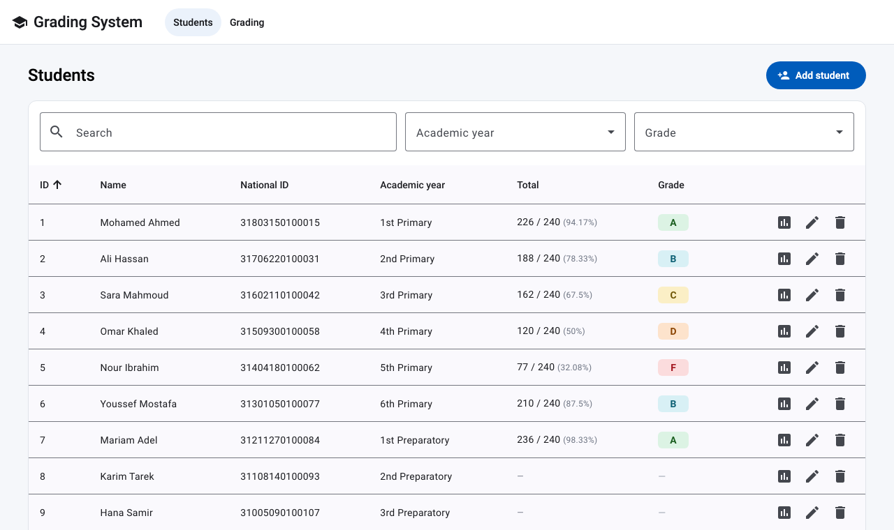
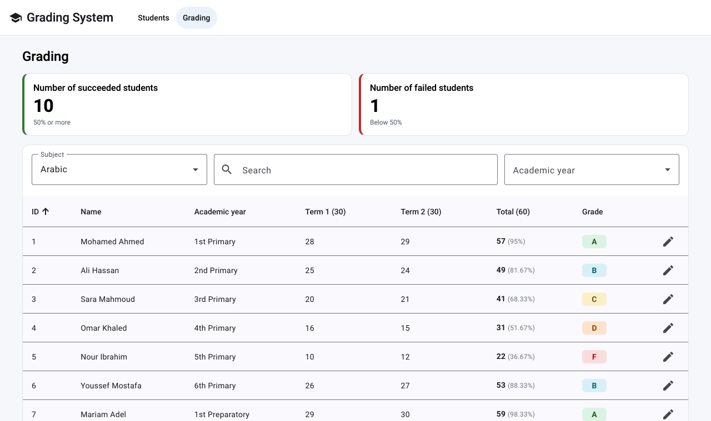
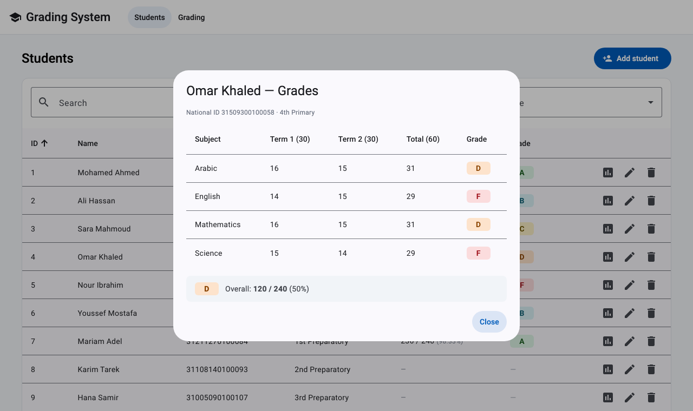
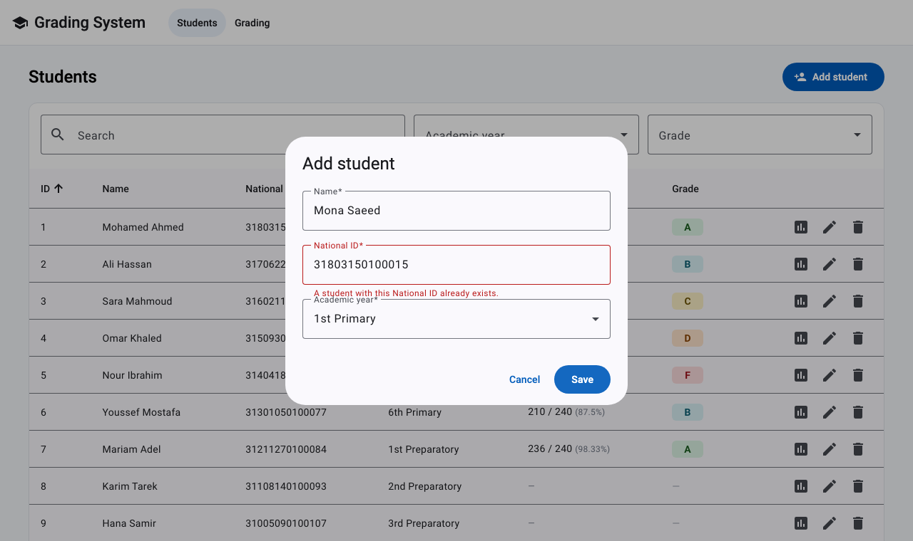
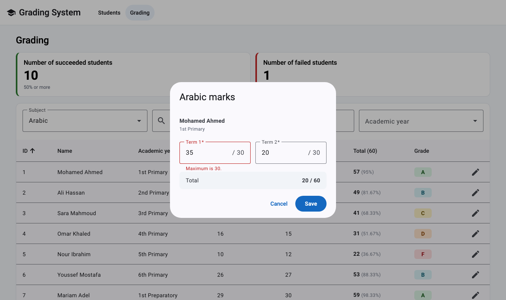
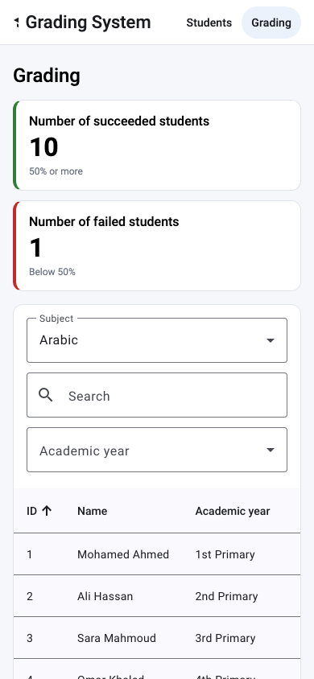

# Grading System

A student grading system: manage students, enter Term 1 and Term 2 marks per subject, calculate totals and grades, and see how many students succeeded or failed.

**Stack:** .NET 10 Web API · Entity Framework Core (Code First) · SQL Server · Angular 22 · Angular Material



---

## Run it

The API creates the database, applies the migration and adds 12 demo students on first start. There's no SQL script to run.

### Option 1: Docker (one command)

Requires [Docker Desktop](https://www.docker.com/products/docker-desktop/).

```bash
docker compose up --build
```

- App: http://localhost:4200
- API documentation (Swagger): http://localhost:5080/swagger

Stop with `docker compose down`. Add `-v` to also delete the database.

### Option 2: Windows with Visual Studio (no Docker)

Uses SQL Server LocalDB, which Visual Studio installs with the *ASP.NET and web development* workload.

1. Open `backend/GradingSystem.sln`, keep the **LocalDB** launch profile selected, and press **F5**. Swagger opens at http://localhost:5080/swagger.
2. In a terminal:
   ```bash
   cd frontend
   npm install
   npm start
   ```
3. Open http://localhost:4200.

### Option 3: macOS / Linux for development

LocalDB is Windows-only, so SQL Server runs in Docker. The API and Angular app run directly.

From the repository root:

```bash
# 1. SQL Server only
docker compose up -d --wait db

# 2. API on http://localhost:5080
cd backend && dotnet run --project API --launch-profile Docker

# 3. In a second terminal, from the repository root: app on http://localhost:4200
cd frontend && npm install && npm start
```

Requirements: [.NET 10 SDK](https://dotnet.microsoft.com/download/dotnet/10.0) and Node.js 22.22+ or 24.15+.

---

## Features

**Students page**
- Add, edit and delete students (delete asks for confirmation).
- Search by name, National ID or academic year. Filter by academic year and by grade.
- Sorting and paging, both done by the server.
- Each student's total, percentage and overall grade, plus a grade report dialog showing every subject.
- Validation: all fields required; National ID exactly 14 digits and unique.

**Grading page**
- Choose a subject to see every student's Term 1, Term 2, total and grade in it.
- Add or edit marks. Each term is out of 30, and a higher mark can't be saved.
- **Number of succeeded students** and **number of failed students** for the subject.
- Search, academic-year filter, sorting and paging.

The layout is responsive: the filters stack and tables scroll sideways on small screens.

---

## Grading rules and assumptions

| Rule | Value |
|------|-------|
| Term mark | Whole number, 0 to 30 |
| Subject total | Term 1 + Term 2, out of 60 |
| A / B / C / D | 90% / 75% / 65% / 50% or above |
| F | Below 50% |

All of these live in one class, `Application/Services/GradeCalculator.cs`.

Decisions where the brief was open:

1. **Exactly 50% passes.** The brief says success is "more than 50%" and failure "less than 50%" but doesn't cover exactly 50%. Since Grade D starts at 50%, a student at 50% has a D, so they pass.
2. **Both terms are required** when marks are saved for a subject.
3. **A student with no marks in a subject** shows "—" there, and counts as neither succeeded nor failed in that subject.
4. **Succeeded/failed counts are per subject**, matching the subject dropdown on the Grading page, and cover all students, not just the visible page.
5. **The grade on the Students page is the overall grade**: all subject totals out of 60 × the number of subjects. It appears once the student has marks in every subject.

---

## Project structure

### Backend: three layers

```
backend/
├── API/                    HTTP: controllers, error middleware, Program.cs (all registrations)
│   ├── Controllers/        StudentsController, GradingController, LookupsController
│   └── Middleware/         ExceptionMiddleware
├── Application/            Business rules
│   ├── DTOs/               Request and response classes, with validation attributes
│   ├── Interfaces/         IStudentService, IGradingService, ILookupService
│   ├── Services/           StudentService, GradingService, LookupService, GradeCalculator
│   └── Exceptions/         NotFoundException, ConflictException, BadRequestException
├── DAL/                    Database
│   ├── Models/             Student, Mark, Subject, AcademicYear
│   ├── Repositories/       All queries
│   ├── Migrations/         EF Core Code First migration
│   ├── AppDbContext.cs     Tables, constraints, seed data for subjects and academic years
│   └── DemoData.cs         Sample students
└── Tests/                  GradeCalculator unit tests
```

A request goes **Controller → Service → Repository → SQL Server**:
- the controller only handles HTTP;
- the service applies the rules (uniqueness, grades);
- the repository holds the queries.

Filtering, sorting and paging run in SQL, so only one page of rows is loaded.

### Frontend

```
frontend/src/app/
├── core/
│   ├── models/             TypeScript interfaces matching the API's DTOs
│   ├── services/           StudentsService, GradingService, LookupsService (HTTP calls)
│   └── error.interceptor.ts
├── shared/                 Confirm dialog, grade badge, form-error helper
└── pages/
    ├── students/           Students page, add/edit dialog, grade report dialog
    └── grading/            Grading page, marks dialog
```

Each page keeps its state in signals: the current query (search, filters, sort, page) and the results. Any change to the query reloads the data, and a newer request cancels an older one.

---

## API

| Method | Route | Description |
|--------|-------|-------------|
| GET | `/api/students` | List. Query: `search`, `academicYearId`, `grade`, `pageNumber`, `pageSize`, `sortBy` (`id`, `name`, `nationalId`, `academicYear`, `total`), `sortDirection` (`asc`, `desc`) |
| GET | `/api/students/{id}` | One student |
| GET | `/api/students/{id}/grades` | Grade report: every subject plus the overall result |
| POST | `/api/students` | Add → `201 Created` |
| PUT | `/api/students/{id}` | Edit |
| DELETE | `/api/students/{id}` | Delete, with their marks → `204 No Content` |
| GET | `/api/grading/{subjectId}` | One page of students with their marks in the subject, plus `succeeded` and `failed`. Same query options; `sortBy` also takes `term1`, `term2` |
| PUT | `/api/grading/{subjectId}/students/{studentId}` | Save `{ "term1": 25, "term2": 8 }`. Adds the first time, updates after |
| GET | `/api/lookups` | Academic years and subjects |

---

## Validation and errors

Rules are checked at three levels:

1. **The Angular forms** catch most mistakes before anything is sent.
2. **The API** checks the DTOs' validation attributes (`[Required]`, `[RegularExpression]`, `[Range]`) and the rules that need the database (unique National ID, the academic year exists).
3. **SQL Server** has a unique index on National ID and check constraints on the National ID format and on term marks (0–30), as a last line of defence.

Every error comes back in the same JSON shape, with field names matching the request:

```json
{
  "title": "Conflict",
  "status": 409,
  "errors": { "nationalId": ["A student with this National ID already exists."] }
}
```

The frontend shows field errors under the matching input. Anything else (server unreachable, not found, unexpected error) appears as a message at the bottom of the screen.

| Status | When |
|--------|------|
| 400 | Invalid input |
| 404 | Student or subject not found |
| 409 | Duplicate National ID |
| 500 | Unexpected error (logged on the server; the client gets a generic message) |

---

## Tests

```bash
cd backend
dotnet test
```

18 unit tests for `GradeCalculator`:
- every grade boundary (54/53, 45/44, 39/38, 30/29 out of 60);
- exactly 50% passes;
- for every possible total, the grade filter's range of totals agrees with the grade shown.

---

## Screenshots

| | |
|---|---|
|  |  |
| Grading page with succeeded and failed counts | Grade report for a student at exactly 50% |
|  |  |
| Duplicate National ID, reported by the API | A mark above 30 can't be saved |

<p align="center"></p>
